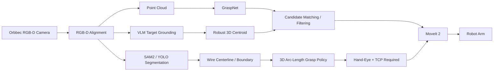

# Orbbec RGB-D Manipulation Stack

> **RGB-D Perception · GraspNet · SAM2 / YOLO · VLM Grounding · 3D Localization · MoveIt 2 · Real Robot Validation**

一个面向真实机器人抓取与操作场景的 RGB-D 感知与执行工程：从 Orbbec 深度相机取流、RGB-D 对齐、点云与 6-DoF 抓取候选，到 VLM 目标定位、线材分割与夹持策略，再到 MoveIt 2 双臂安全执行验证。

项目重点不是“跑通一个模型 Demo”，而是把 **相机、几何、深度、学习模型、机械臂规划和失败路径** 串成可验证的工程链路。

---

## Project highlights

### RGB-D perception

- 支持 **Orbbec DaBai DC1、Gemini 336L、Astra Pro Plus** 多相机后端；
- RGB / Depth 对齐、内参管理、深度尺度换算与点云反投影；
- 设备 / SDK 差异封装，保留 PyOrbbecSDK v1 / v2 不同后端；
- 持续取流、保存、回放和诊断工具。

### 6-DoF grasp planning

- 集成 **GraspNet-baseline**；
- RGB-D → 点云 → 6-DoF grasp candidates → 几何过滤 → 可视化；
- 对抓取候选做距离、得分、工作空间和接近方向等规则过滤；
- 支持连续推理 GUI 和离线复现。

### Semantic target grounding

- 使用 VLM 将自然语言目标映射到 2D bbox；
- bbox 内深度通过中位数带宽估计稳健 3D 质心；
- 深度不足时显式失败，不返回伪造 3D 坐标；
- VLM 只在用户提交目标时调用，不阻塞常驻感知循环。

### Wire grasping

最新线材链路包含：

- SAM2 自动线材分割；
- 端点 / 中心线路径提取；
- 端子区域检测；
- 人工确认“金属端子—绝缘线身”交界；
- 从交界沿真实 3D 线身弧长后退 **10 mm** 的夹持中心策略；
- 夹爪闭合方向与局部线材切向垂直；
- 缺少真实尺度、支撑面法向、路径歧义或线长不足时 fail-closed。

系统不会把像素距离冒充毫米，也不会在缺少手眼标定和 TCP 变换时把相机系预览标成可执行机器人位姿。

### MoveIt 2 execution

项目已经包含致行 AR6E-R700 双臂 MoveIt 工具链：

- 关节姿态录制；
- YAML 姿态管理；
- 双目标规划；
- plan-only 验证；
- 关节限位 / 超限失败路径；
- 经现场授权的真实双位姿执行验证。

---

## Validated results

以下数字来自仓库内对应测试报告，均带明确测试场景和边界，不作为泛化性能承诺。

| Subsystem | Validated result |
|---|---|
| Gemini 336L RGB-D capture | **30.06 FPS** 短时复测；历史约 **29.96 FPS / 1031 s / 30901 frames / 0 errors** |
| GraspNet inference | 平均约 **176 ms / 5.68 FPS**（冻结场景、RTX 4060 Laptop） |
| VLM target naming | **36 / 36 = 100%**，平均 **1.15 s**、最大 **2.36 s**（指定冻结桌面评测集） |
| bbox → 3D centroid | 平均约 **0.45 ms**、最大 **0.63 ms**；有效深度不足显式报错 |
| MoveIt pose B → A | 真机成功；最大关节误差约 **0.278°**；约 **2.19 s** |
| MoveIt pose A → B | 真机成功；最大关节误差约 **0.315°**；约 **2.19 s** |
| Wire grasp policy | 文档记录 **133 项本地测试通过**；弯线使用真实 3D 弧长，不做像素/mm 猜测 |

### Important negative result

阶段二的侧视办公桌场景中，VLM 点名虽然达到 36/36，但“目标 → GraspNet 最近候选”的闭环高亮为 **0/33**。

项目没有把这个结果包装成“自动抓取成功”，而是定位到：

- 相机侧视；
- 有效抓取候选集中在错误工作区；
- 白色 / 反光物体存在深度空洞；
- 尚未完成目标工位的俯视安装和手眼标定。

因此当前结论是：

> **感知、定位和 MoveIt 执行子系统均已分别验证，但线材自动抓取仍需要真实三维路径、手眼标定、TCP 补偿和工位闭环验收。**

这也是项目中明确保留的系统安全边界。

---

## Architecture



---

## Repository structure

```text
orbbec/
├── README.md
├── graspnet_orbbec/
│   ├── capture/              # camera backends & RGB-D alignment
│   ├── pointcloud/           # back-projection / workspace / geometry
│   ├── infer/                # GraspNet inference & filtering
│   ├── segmentation/         # SAM2 wire segmentation + grasp policy
│   ├── vlm/                  # VLM grounding + bbox→3D localization
│   ├── arm/                  # MoveIt two-pose execution toolkit
│   ├── viz/                  # point cloud / grasp visualization
│   ├── configs/
│   ├── tests/
│   └── docs/
└── scripts/
```

---

## Camera backends

| Camera | Integration | Notes |
|---|---|---|
| **DaBai DC1** | PyOrbbecSDK v1 | 当前默认；支持自动线材识别入口 |
| **Gemini 336L** | PyOrbbecSDK v2 | 阶段二主要 RGB-D / VLM / GraspNet 验证设备 |
| **Astra Pro Plus** | PyOrbbecSDK v1 + fallback path | 保留兼容，用于阶段一对比 |

不同 SDK major version 不在同一进程里混用，代码通过 camera backend 隔离。

---

## Wire grasp policy

当前策略：

```text
metal terminal
     │
     ▼
[metal / insulation boundary]
     │
     └── follow real 3D centerline arc length 10 mm
                                      │
                                      ▼
                               grasp center
                                      │
                          closing axis ⟂ wire tangent
```

关键状态：

| Status | Meaning |
|---|---|
| `boundary_required` | 尚未确认金属/绝缘交界 |
| `metric_path_required` | 没有真实米制 3D 路径 |
| `wire_instance_ambiguous` | 线材实例 / 中心线路径有歧义 |
| `insufficient_wire_length` | 交界后线身不足目标距离 |
| `support_plane_required` | 能算位置但不能确定闭合方向 |
| `camera_frame_preview_ready` | 相机系位置 / 方向可预览，但仍非机器人可执行位姿 |

详细说明：[WIRE_GRASP_POLICY.md](graspnet_orbbec/docs/WIRE_GRASP_POLICY.md)

---

## MoveIt 2 real-robot validation

`graspnet_orbbec/arm/` 提供：

- `record_joint_pose.py`
- `poses_io.py`
- `moveit_two_joint_goals.py`
- joint name / safety constants
- plan-only and failure-path tests

2026-09-14 的现场记录中，AR6E-R700 双臂在 MoveIt `dual_arms` 规划组下完成了 pose B → A → B 的真实执行验证，速度缩放为 0.10。

详细记录：[MoveIt 双位姿验证记录](graspnet_orbbec/docs/MoveIt双位姿验证记录_20260914.md)

---

## VLM + 3D localization

目标定位采用两阶段：

```text
natural-language target
       ↓
VLM bbox
       ↓
aligned depth ROI
       ↓
valid-depth filtering
       ↓
median depth band
       ↓
3D centroid in camera frame
```

相比直接使用 bbox 中心单像素，这种方法更能抵抗：

- 深度空洞；
- bbox 边缘背景；
- 单点深度噪声。

当有效点不足时，`InsufficientDepthError` 直接终止定位，不生成假坐标。

---

## Quick start

```bash
git clone https://github.com/NingXYS/orbbec.git
cd orbbec/graspnet_orbbec

bash scripts/setup_env.sh
source scripts/activate.sh
sudo bash scripts/install_udev.sh
```

DaBai DC1 实时 GUI：

```bash
python scripts/run_live_gui.py --no-target
```

线材自动识别：

```bash
python scripts/run_live_gui.py --wire-auto --no-target
```

单帧 RGB-D + GraspNet：

```bash
python scripts/run_pipeline.py --once --live
```

---

## Tests

```bash
cd graspnet_orbbec
source scripts/activate.sh
pytest -q
```

测试覆盖：

- RGB-D 反投影；
- 多相机后端；
- 深度与过滤；
- GraspNet candidate matching；
- VLM client / target query；
- bbox → 3D localization；
- SAM2 自动线材分割；
- 3D wire grasp policy；
- MoveIt failure paths；
- 离线 pipeline。

---

## Tech stack

| Area | Technologies |
|---|---|
| Robotics | ROS 2, MoveIt 2, RViz, robot joint-state / action interfaces |
| Perception | Orbbec RGB-D, OpenCV, Open3D, depth alignment, point clouds |
| Deep Learning | PyTorch, CUDA, GraspNet, SAM2, YOLO |
| Vision-language | VLM grounding, structured JSON output |
| Geometry | camera intrinsics, back-projection, 3D centroid, arc-length interpolation |
| Motion | joint pose recording, MoveIt planning / execution, fail-path classification |
| Engineering | Python, C++, Linux, Conda, pytest, reproducible test reports |

---

## Documentation

Recommended reading:

- [DaBai DC1 integration](graspnet_orbbec/docs/DABAI_DC1.md)
- [Deployment](graspnet_orbbec/docs/DEPLOY.md)
- [Wire segmentation](graspnet_orbbec/docs/WIRE_SEGMENTATION.md)
- [Wire grasp policy](graspnet_orbbec/docs/WIRE_GRASP_POLICY.md)
- [Phase 2 perception report](graspnet_orbbec/docs/phase2_report.md)
- [Cross-host ROS](graspnet_orbbec/docs/cross_host_ros.md)
- [MoveIt safe execution](graspnet_orbbec/docs/moveit_safe_exec.md)
- [MoveIt real-robot validation](graspnet_orbbec/docs/MoveIt双位姿验证记录_20260914.md)

---

## Resume-oriented highlights

For robotics / embodied AI / perception roles, this project demonstrates:

- end-to-end RGB-D perception engineering rather than isolated model inference;
- multi-camera SDK integration and depth calibration;
- GraspNet 6-DoF grasp generation;
- VLM semantic grounding + geometric 3D localization;
- SAM2-based deformable-object / wire segmentation;
- safety-oriented grasp policy with explicit uncertainty states;
- MoveIt planning and authorized real-robot execution;
- quantitative evaluation and explicit documentation of failed system-level conditions.

---

## Related repositories

- [voice_control](https://github.com/NingXYS/voice_control) — robot voice interaction, massage and exhibition scenarios
- [voice_hub](https://github.com/NingXYS/voice_hub) — multi-robot streaming voice Agent server

---

## Safety & current boundary

Do not directly convert camera-frame grasp previews into robot commands.

Before autonomous grasp execution, the complete chain still requires:

1. fixed production camera installation;
2. hand-eye calibration;
3. camera → base transform validation;
4. TCP calibration / compensation;
5. reachable workspace and collision validation;
6. real gripper geometry;
7. emergency-stop readiness;
8. closed-loop real grasp acceptance tests.

The repository deliberately keeps these boundaries explicit rather than hiding them behind a “success” demo.

---

## Security

Keep cloud credentials in environment variables or local secret files excluded from Git. Never commit API keys.
